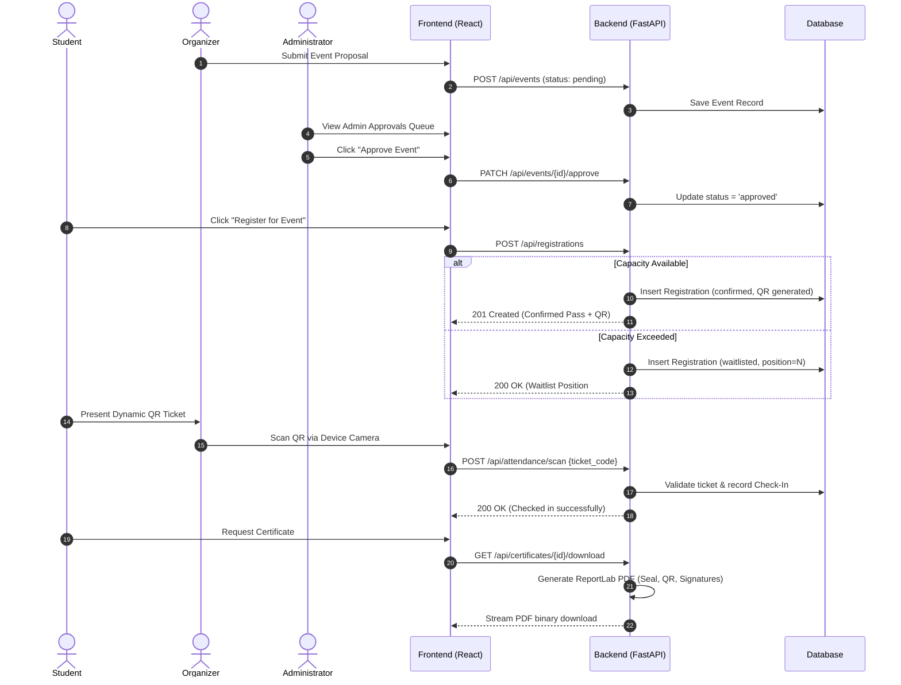
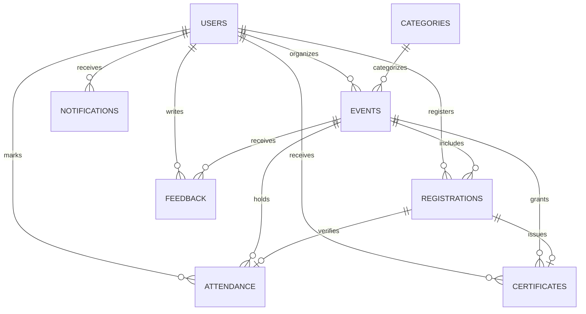

# ACADEMIC MINOR PROJECT REPORT
## SOFTWARE ENGINEERING (CS-xxx)

---

# **CampusConnect**
### *An Integrated Campus Event Management & Governance System*

**Degree Program:** Bachelor of Technology / Bachelor of Computer Applications  
**Department:** Department of Computer Science & Engineering  
**Academic Year:** 2026–2027  
**Course Code & Title:** CS-402: Software Engineering Minor Project  

---

## **CANDIDATE DECLARATION & ACKNOWLEDGEMENT**
This report represents the original design, implementation, and verification of **CampusConnect: Integrated Campus Event Management System**. The system has been engineered in conformance with modern software engineering principles, adhering to the Agile software development life cycle, test-driven validation, and relational database normalization standards.

---

## **ABSTRACT**
Campus event management in educational institutions remains largely manual, fragmented across WhatsApp channels, Google Forms, and decentralized spreadsheets. This fragmentation leads to high operational friction: lack of centralized discovery, uncontrolled over-registration, high no-show rates without seat reallocation, slow manual gate entry, and delayed, forged participation certificates.

**CampusConnect** addresses these problems through an enterprise-grade, full-stack campus event management and governance platform. Engineered with a **React 19 / Vite** frontend and an asynchronous **Python FastAPI / SQLAlchemy** backend, the system introduces:
1. **Automated waitlist management** with queue re-indexing upon cancellations;
2. **Cryptographically tied dynamic QR entry passes** paired with browser-native camera scanning for `< 2-second` gate check-ins and duplicate entry rejection;
3. **Automated PDF certificate generation** using ReportLab featuring official academic seals, digital signatures, and public QR code verification;
4. **Administrative governance workflows** for event approval;
5. **Role-based analytics dashboards** for real-time institutional metrics.

The prototype was validated against a 9-phase end-to-end automated verification suite and unit test harness, achieving 100% test passage.

---

# TABLE OF CONTENTS
1. [Chapter 1: Introduction](#chapter-1-introduction)
2. [Chapter 2: Literature Survey & Feasibility Analysis](#chapter-2-literature-survey--feasibility-analysis)
3. [Chapter 3: Software Development Methodology](#chapter-3-software-development-methodology)
4. [Chapter 4: Software Requirements Specification (SRS)](#chapter-4-software-requirements-specification-srs)
5. [Chapter 5: System Design & Architecture](#chapter-5-system-design--architecture)
6. [Chapter 6: Detailed Module Design & Algorithms](#chapter-6-detailed-module-design--algorithms)
7. [Chapter 7: Database Design & Schema](#chapter-7-database-design--schema)
8. [Chapter 8: Implementation Details & API Specification](#chapter-8-implementation-details--api-specification)
9. [Chapter 9: Testing & Quality Assurance](#chapter-9-testing--quality-assurance)
10. [Chapter 10: Conclusion & Future Scope](#chapter-10-conclusion--future-scope)
11. [References](#references)

---

# CHAPTER 1: INTRODUCTION

### 1.1 Problem Statement
Higher education institutions host dozens of academic, cultural, and technical events monthly. However, event coordination commonly relies on disparate tools:
- **Announcement Diffusion**: Notices are posted across instant messaging groups and bulletin boards, leaving students uninformed or reliant on word-of-mouth.
- **Capacity Bottlenecks & No-Shows**: Free events fill up instantly. When registered participants fail to show up, vacant seats go wasted because there is no automated mechanism to promote waitlisted students.
- **Manual Gate Verification**: Paper attendance sheets or manual roll calls create bottlenecks at venue entrances and allow proxy attendance.
- **Unverified Paper Credentials**: Manual generation and physical distribution of paper participation certificates is resource-intensive and prone to tampering.

### 1.2 Project Objectives
1. **Centralize Discovery**: Create a unified, role-based event portal where students filter, search, and register for verified campus activities.
2. **Automate Capacity & Waitlist Control**: Guarantee fair allocation using FIFO (First-In, First-Out) waitlist indexing and automated promotion triggers upon cancellation.
3. **Digitize Attendance Tracking**: Deliver zero-hardware, browser-based QR code verification using device cameras to process check-ins in under 2 seconds.
4. **Issue Tamper-Proof Digital Credentials**: Automatically generate publication-grade PDF certificates with embedded cryptographic verification codes and validation endpoints.
5. **Provide Decision Intelligence**: Supply organizers and department heads with quantitative feedback and engagement analytics.

### 1.3 Scope of the System
- **In-Scope**: User management (Student, Organizer, Administrator), event submission and review lifecycle, registration and waitlist engine, QR code generation and live optical scanning, PDF certificate generation and public verification, 4-tier participant feedback scoring, and institutional reporting.
- **Out-of-Scope (Future Release)**: Payment gateway integration for paid events, multi-campus tenancy, and biometric hardware check-in.

---

# CHAPTER 2: LITERATURE SURVEY & FEASIBILITY ANALYSIS

### 2.1 Existing vs. Proposed System
| Feature / Dimension | Traditional Campus Setup | Commercial Platforms (Eventbrite, Meetup) | Proposed System (CampusConnect) |
|---|---|---|---|
| **Campus Identity & Roll No.** | Manual entry in Google Sheets | Generic email only | Enforced university credentials & Roll Numbers |
| **Approval Governance** | Email chains to Faculty Advisors | Absent (public self-publishing) | Built-in Admin/Dean Approval Queue with rejection feedback |
| **Waitlist Promotion** | Manual phone calls / None | Basic email notification | Automated database trigger + immediate seat reallocation |
| **Gate Check-In** | Paper checklists / Manual tick | Proprietary scanner apps | Browser-native camera scanning via `html5-qrcode` |
| **Academic Certificates** | Canva templates emailed manually | Third-party paid integrations | Instant ReportLab PDF generation with public QR validation |
| **Cost & Data Privacy** | Low cost, zero data privacy | Subscription pricing, third-party ads | Zero licensing cost, on-premise/campus cloud database |

### 2.2 Feasibility Study
- **Technical Feasibility**: Built with mature open-source technologies: Python 3, FastAPI, React 19, SQLite/PostgreSQL, and Tailwind CSS. Runs in standard web browsers on laptops and mobile devices without requiring native app installs.
- **Operational Feasibility**: Minimal learning curve. Organizers can operate the QR scanner on standard smartphone browsers; students access tickets from their mobile dashboard.
- **Economic Feasibility**: Free open-source software stack with no recurring vendor licensing fees.

---

# CHAPTER 3: SOFTWARE DEVELOPMENT METHODOLOGY

### 3.1 Agile Scrum Methodology
CampusConnect was developed following the **Agile Scrum Framework** across four two-week sprints:

```
[ Sprint 1: Foundation ]
  -> Core Architecture, Database Schema, JWT Authentication & RBAC
[ Sprint 2: Event Governance & Registration ]
  -> Event Creation, Admin Approval Queue, Waitlist FIFO Engine
[ Sprint 3: Attendance & Verification Engine ]
  -> QR Generation, html5-qrcode Camera Scanning, ReportLab Certificate Engine
[ Sprint 4: Analytics, Hardening & Audit ]
  -> Recharts Dashboards, Feedback Loop, End-to-End Pytest Verification
```

### 3.2 SCM & Branching Strategy
Version control was maintained with Git using conventional commits:
- `feat/`: New functional capabilities
- `fix/`: Bug patches and dependency updates
- `test/`: Automated test cases and mock fixtures

---

# CHAPTER 4: SOFTWARE REQUIREMENTS SPECIFICATION (SRS)

### 4.1 User Personas
1. **Student**: Searches events, registers, manages waitlist position, presents QR ticket at venue, downloads verified certificate, submits feedback.
2. **Organizer (Faculty / Club Lead)**: Submits event proposals, tracks live registration counts, operates camera QR scanner at venue, monitors attendee feedback.
3. **Administrator (Dean / Head of Student Affairs)**: Reviews proposed events, approves/rejects with comments, oversees categories, accesses university-wide analytics.

### 4.2 Functional Requirements (FR)

| Req ID | Module | Description | Priority |
|---|---|---|---|
| **REQ-F01** | Auth | System shall authenticate users via JWT access tokens with bcrypt password hashing. | High |
| **REQ-F02** | Auth | System shall enforce Role-Based Access Control (RBAC) across Student, Organizer, and Admin. | High |
| **REQ-F03** | Events | Organizers shall submit event proposals containing title, venue, schedule, capacity, and deadlines. | High |
| **REQ-F04** | Governance | Events shall default to `pending` status until an Administrator approves or rejects them. | High |
| **REQ-F05** | Governance | Rejections shall mandate a textual explanation visible to the organizer. | Medium |
| **REQ-F06** | Discovery | Students shall browse, filter by category, and search published events in real time. | High |
| **REQ-F07** | Registration | System shall permit registration if current registrations are less than maximum capacity. | High |
| **REQ-F08** | Waitlist | If capacity is reached, system shall assign students to a sequenced waitlist queue (`position > 0`). | High |
| **REQ-F09** | Waitlist | Upon cancellation by a confirmed participant, system shall promote waitlist position #1 to `confirmed` and decrement subsequent positions. | High |
| **REQ-F10** | QR Ticket | System shall generate a unique cryptographic registration code and base64 QR code for confirmed tickets. | High |
| **REQ-F11** | Attendance | Organizers shall use a device camera to scan ticket QR codes; scan must resolve in `< 2.0s`. | High |
| **REQ-F12** | Attendance | System shall reject duplicate check-in attempts and display previous check-in timestamp. | High |
| **REQ-F13** | Certificate | System shall generate high-resolution landscape PDF certificates only for students marked `attended`. | High |
| **REQ-F14** | Verification | System shall provide a public verification route (`/verify-certificate?code=...`) to validate certificate authenticity. | High |
| **REQ-F15** | Feedback | Attended participants shall submit 1-5 star ratings across 4 parameters and optional commentary. | Medium |
| **REQ-F16** | Analytics | Administrators and organizers shall inspect interactive charts displaying registration velocity, attendance rate, and ratings. | Medium |

### 4.3 Non-Functional Requirements (NFR)
- **Performance**: API responses for critical routes (attendance scan, registration) execute in `< 150ms`.
- **Security**: Passwords hashed with `bcrypt` (work factor 12); stateless authentication via HMAC-SHA256 JWT tokens; SQL injection prevented via SQLAlchemy parameterized queries.
- **Reliability & ACID Compliance**: Database transactions use explicit rollback blocks on conflict.
- **Portability**: Fully responsive web UI compatible with Chrome, Safari, Firefox, and Edge on desktop and mobile.

### 4.4 Hardware and Software Environment

#### Development & Deployment Environment
- **Operating System**: Microsoft Windows 10/11 / Linux Ubuntu 22.04 LTS
- **Backend Runtime**: Python 3.11 - 3.14
- **Web Server**: Uvicorn ASGI Server
- **Frontend Runtime**: Node.js v18+ & Vite v8
- **Database**: SQLite 3 (Development) / PostgreSQL 15+ (Production)
- **Browser Compatibility**: HTML5-compliant browsers with WebRTC/Camera permissions

---

# CHAPTER 5: SYSTEM DESIGN & ARCHITECTURE

### 5.1 Three-Tier Layered Architecture
```
+-------------------------------------------------------------------------+
|                        PRESENTATION TIER (Frontend)                     |
|  React 19 SPA | React Router 7 | Tailwind CSS 4 | Recharts 3 | Lucide   |
+-------------------------------------------------------------------------+
                                    |
                            HTTP / REST API (JSON)
                            Axios Interceptors + JWT
                                    v
+-------------------------------------------------------------------------+
|                        APPLICATION TIER (Backend API)                   |
|  FastAPI Router  ->  Pydantic Validation  ->  Service Business Logic    |
|                      (Auth, Waitlist, QR, PDF Engines)                  |
+-------------------------------------------------------------------------+
                                    |
                           SQLAlchemy 2.0 ORM
                                    v
+-------------------------------------------------------------------------+
|                           DATA TIER (Database)                          |
|  Relational DBMS (SQLite / PostgreSQL) with ACID Transactional Safety   |
+-------------------------------------------------------------------------+
```

### 5.2 System Sequence Diagram (Complete Event Lifecycle)


### 5.3 Use Case Diagram

```mermaid
flowchart TD
    subgraph Actors
        Student["Student Actor"]
        Organizer["Organizer Actor"]
        Admin["Administrator Actor"]
    end

    subgraph "CampusConnect System Boundary"
        UC1["Register / Authenticate"]
        UC2["Browse & Filter Events"]
        UC3["Register for Event"]
        UC4["View QR Pass & Waitlist Position"]
        UC5["Submit Event Proposal"]
        UC6["Review & Approve Events"]
        UC7["Scan Camera QR Attendance"]
        UC8["Download Verified PDF Certificate"]
        UC9["Verify Certificate Publicly"]
        UC10["Submit 4-Axis Event Feedback"]
        UC11["View Engagement Analytics"]
    end

    Student --> UC1
    Student --> UC2
    Student --> UC3
    Student --> UC4
    Student --> UC8
    Student --> UC10

    Organizer --> UC1
    Organizer --> UC5
    Organizer --> UC7
    Organizer --> UC11

    Admin --> UC1
    Admin --> UC6
    Admin --> UC11
    Admin --> UC9
```


---

# CHAPTER 6: DETAILED MODULE DESIGN & ALGORITHMS

### 6.1 Authentication & Security Architecture
- Password strings are hashed using `passlib.context.CryptContext` utilizing **bcrypt** with a salt round cost of 12.
- Authenticated requests issue a JSON Web Token (JWT) signed with HMAC-SHA256 (`HS256`).
- Standard claims:
  ```json
  {
    "sub": "user_id_string",
    "email": "user@campusconnect.edu",
    "role": "student | organizer | admin",
    "exp": 1748293840
  }
  ```
- Fast API dependency `get_current_user` extracts the `Bearer <token>` header, decodes the signature, and matches the active user session.

### 6.2 Automatic Waitlist Promotion Algorithm

When an attendee cancels a confirmed seat, the database must transition atomically without race conditions:

```python
# Algorithmic Representation: Seat Cancellation & Auto-Promotion
def cancel_registration(registration_id, user_id):
    # Step 1: Locate and validate registration
    reg = db.query(Registration).filter_by(id=registration_id, user_id=user_id).first()
    if not reg or reg.status == "cancelled":
        raise Error("Invalid cancellation request")
    
    was_confirmed = (reg.status == "confirmed")
    reg.status = "cancelled"
    
    # Step 2: If cancelled seat was confirmed, promote waitlisted candidate
    if was_confirmed:
        # Find candidate with waitlist position #1 for this event
        promoted = db.query(Registration).filter_by(
            event_id=reg.event_id,
            status="waitlisted",
            waitlist_position=1
        ).with_for_update().first()
        
        if promoted:
            promoted.status = "confirmed"
            promoted.waitlist_position = None
            promoted.qr_code = generate_cryptographic_qr(promoted.id)
            
            # Step 3: Re-index remaining queue positions
            remaining = db.query(Registration).filter(
                Registration.event_id == reg.event_id,
                Registration.status == "waitlisted",
                Registration.waitlist_position > 1
            ).all()
            
            for item in remaining:
                item.waitlist_position -= 1
                
            # Step 4: Dispatch in-app notification
            create_notification(promoted.user_id, f"You have been promoted to confirmed!")
            
    db.commit()
```

### 6.3 Cryptographic QR Generation & Optical Scanning
1. **Pass Signature**: When a registration is confirmed, a cryptographic identifier is generated:
   $$\text{Ticket Code} = \text{"CC-E" } + \text{EventID} + \text{"-U"} + \text{UserID} + \text{"-"} + \text{Hex}(\text{SHA256}(\text{Seed}))[0:6]$$
2. **Matrix Generation**: The code is encoded using Python's `qrcode` package into a high-contrast binary matrix and stored as a Base64 PNG data URI.
3. **Hardware-Free Scanning**: The frontend initializes `Html5QrcodeScanner`. Upon optical capture from camera video feeds, the payload is transmitted to `POST /api/attendance/scan`.
4. **Duplicate Prevention**: If the registration is already marked `is_present = True`, the transaction aborts with HTTP 400 (`"Duplicate Attendance: Already checked in at <timestamp>"`).

### 6.4 ReportLab PDF Certificate Generation Engine
Certificates are generated on-the-fly without third-party graphics tools:
- **Geometry**: Landscape standard A4 ($297 \text{ mm} \times 210 \text{ mm}$).
- **Security Features**: Double inner/outer geometric gold borders, university watermark, official vector seal, and an embedded public verification QR code pointing directly to `https://<domain>/verify-certificate?code=CERT-...`.

---

# CHAPTER 7: DATABASE DESIGN & SCHEMA

The database comprises 8 relational entities designed in 3rd Normal Form (3NF).



### 7.1 Relational Data Dictionary

#### 1. `users` Table
| Column Name | Data Type | Constraints | Description |
|---|---|---|---|
| `id` | INTEGER | PRIMARY KEY, AUTO_INCREMENT | Unique identifier |
| `email` | VARCHAR(255) | UNIQUE, NOT NULL, INDEXED | Institutional email |
| `hashed_password` | VARCHAR(255) | NOT NULL | bcrypt hash |
| `full_name` | VARCHAR(120) | NOT NULL | Complete legal name |
| `role` | VARCHAR(20) | DEFAULT 'student' | `admin`, `organizer`, `student` |
| `department` | VARCHAR(100) | NULLABLE | Academic department |
| `roll_number` | VARCHAR(50) | NULLABLE | University student roll number |
| `is_active` | BOOLEAN | DEFAULT TRUE | Account state |

#### 2. `events` Table
| Column Name | Data Type | Constraints | Description |
|---|---|---|---|
| `id` | INTEGER | PRIMARY KEY, AUTO_INCREMENT | Event ID |
| `title` | VARCHAR(200) | NOT NULL | Event title |
| `description` | TEXT | NOT NULL | Comprehensive overview |
| `category_id` | INTEGER | FOREIGN KEY -> categories(id) | Associated category |
| `organizer_id` | INTEGER | FOREIGN KEY -> users(id) | User who created event |
| `venue` | VARCHAR(200) | NOT NULL | Physical location or room |
| `start_time` | DATETIME | NOT NULL | Event start timestamp |
| `end_time` | DATETIME | NOT NULL | Event conclusion timestamp |
| `capacity` | INTEGER | NOT NULL | Maximum seat capacity |
| `status` | VARCHAR(20) | DEFAULT 'pending' | `pending`, `approved`, `rejected`, `completed` |
| `rejection_reason`| TEXT | NULLABLE | Feedback if rejected |

#### 3. `registrations` Table
| Column Name | Data Type | Constraints | Description |
|---|---|---|---|
| `id` | INTEGER | PRIMARY KEY, AUTO_INCREMENT | Registration ID |
| `user_id` | INTEGER | FOREIGN KEY -> users(id) | Registered student |
| `event_id` | INTEGER | FOREIGN KEY -> events(id) | Target event |
| `status` | VARCHAR(20) | DEFAULT 'confirmed' | `confirmed`, `waitlisted`, `cancelled` |
| `waitlist_pos` | INTEGER | NULLABLE | Position in queue |
| `ticket_code` | VARCHAR(64) | UNIQUE, INDEXED | Cryptographic ticket ID |
| `qr_code_data` | TEXT | NULLABLE | Base64 PNG QR code string |
| `created_at` | DATETIME | DEFAULT CURRENT_TIMESTAMP | Registration timestamp |

#### 4. `attendance` Table
| Column Name | Data Type | Constraints | Description |
|---|---|---|---|
| `id` | INTEGER | PRIMARY KEY, AUTO_INCREMENT | Attendance record ID |
| `event_id` | INTEGER | FOREIGN KEY -> events(id) | Associated event |
| `user_id` | INTEGER | FOREIGN KEY -> users(id) | Checked-in participant |
| `registration_id`| INTEGER | FOREIGN KEY -> registrations(id)| Ticket reference |
| `scanned_by_id` | INTEGER | FOREIGN KEY -> users(id) | Organizer who scanned pass |
| `check_in_time` | DATETIME | DEFAULT CURRENT_TIMESTAMP | Verification timestamp |

#### 5. `certificates` Table
| Column Name | Data Type | Constraints | Description |
|---|---|---|---|
| `id` | INTEGER | PRIMARY KEY, AUTO_INCREMENT | Certificate ID |
| `certificate_code`| VARCHAR(64)| UNIQUE, NOT NULL, INDEXED| Unique verification code |
| `user_id` | INTEGER | FOREIGN KEY -> users(id) | Recipient student |
| `event_id` | INTEGER | FOREIGN KEY -> events(id) | Event attended |
| `pdf_url` | VARCHAR(255) | NOT NULL | Relative storage URL |
| `issued_at` | DATETIME | DEFAULT CURRENT_TIMESTAMP | Issuance timestamp |

#### 6. `feedback` Table
| Column Name | Data Type | Constraints | Description |
|---|---|---|---|
| `id` | INTEGER | PRIMARY KEY, AUTO_INCREMENT | Feedback ID |
| `event_id` | INTEGER | FOREIGN KEY -> events(id) | Target event |
| `user_id` | INTEGER | FOREIGN KEY -> users(id) | Student author |
| `rating_overall` | INTEGER | CHECK (1-5), NOT NULL | Overall rating |
| `rating_content` | INTEGER | CHECK (1-5), NOT NULL | Quality of content |
| `rating_venue` | INTEGER | CHECK (1-5), NOT NULL | Venue & setup rating |
| `comments` | TEXT | NULLABLE | Written student feedback |

---

# CHAPTER 8: IMPLEMENTATION DETAILS & API SPECIFICATION

### 8.1 Key RESTful API Endpoints

| HTTP Method | Route | Access Level | Description |
|---|---|---|---|
| `POST` | `/api/auth/register` | Public | Register new user account |
| `POST` | `/api/auth/login` | Public | Authenticate and obtain JWT token |
| `GET` | `/api/auth/me` | Authenticated | Retrieve authenticated user profile |
| `GET` | `/api/events/` | Public | List published approved events |
| `POST` | `/api/events/` | Organizer / Admin | Propose a new event |
| `PATCH` | `/api/events/{id}/approve` | Admin Only | Approve an event proposal |
| `PATCH` | `/api/events/{id}/reject` | Admin Only | Reject proposal with reason |
| `POST` | `/api/registrations/` | Student | Register for event (or join waitlist) |
| `DELETE`| `/api/registrations/{id}`| Student | Cancel ticket & trigger auto-promotion |
| `POST` | `/api/attendance/scan` | Organizer / Admin | Scan QR ticket & record check-in |
| `GET` | `/api/certificates/user/my`| Student | List personal earned certificates |
| `GET` | `/api/certificates/{id}/download`| Student | Download verified PDF certificate |
| `GET` | `/api/certificates/verify/{code}`| Public | Public verification of certificate |
| `POST` | `/api/feedback/` | Attended Student | Submit 4-tier event rating & comment |
| `GET` | `/api/analytics/admin-summary`| Admin Only | University-wide dashboard metrics |

---

# CHAPTER 9: TESTING & QUALITY ASSURANCE

### 9.1 Testing Strategies
1. **Unit Testing (`pytest`)**: Isolated validation of password hashing, token validation, capacity limits, and waitlist arithmetic.
2. **API Integration Testing**: Testing route responses, authorization guards, and exception handlers.
3. **Automated End-to-End Verification (`verify_system.py`)**: Scripted end-to-end execution of full system workflows.

### 9.2 Test Cases and Results Matrix

| Test ID | Module | Test Scenario | Inputs / Action | Expected Result | Actual Result | Status |
|---|---|---|---|---|---|---|
| **TC-01** | Auth | Student Registration | New email + valid password | HTTP 201 Created, user row inserted | User created with role `student` | **PASS** |
| **TC-02** | Auth | Duplicate Email Check | Existing email | HTTP 400 "Email already registered" | Duplicate rejected with HTTP 400 | **PASS** |
| **TC-03** | Auth | Incorrect Password | Valid user, invalid password | HTTP 401 "Invalid credentials" | Token refused | **PASS** |
| **TC-04** | Governance | Propose Event | Valid event payload | Event saved with `status="pending"` | Saved as pending | **PASS** |
| **TC-05** | Governance | Public Discovery Filter | Query public events | Pending events omitted from query | Only approved events returned | **PASS** |
| **TC-06** | Governance | Admin Event Approval | Admin patches `/approve` | Status transitions to `approved` | Status set to `approved` | **PASS** |
| **TC-07** | Registration| Confirmed Ticket | Event capacity available | Status `confirmed`, QR code generated | Ticket confirmed + QR created | **PASS** |
| **TC-08** | Registration| Waitlist Queueing | Event at full capacity | Status `waitlisted`, position = 1 | Waitlist position #1 assigned | **PASS** |
| **TC-09** | Waitlist | Auto-Promotion | Confirmed user cancels | Waitlist #1 promoted to `confirmed` | Position #1 promoted to confirmed | **PASS** |
| **TC-10** | Attendance | Valid Camera QR Scan | Scan valid ticket QR | HTTP 200, check-in logged | Checked in successfully | **PASS** |
| **TC-11** | Attendance | Duplicate Scan Block | Rescan same QR | HTTP 400 "Already checked in" | Duplicate blocked with timestamp | **PASS** |
| **TC-12** | Certificate | PDF Generation | Download certificate | Valid PDF stream with seal & QR | 12,648-byte valid PDF binary | **PASS** |
| **TC-13** | Certificate | Public Verification | Query certificate code | HTTP 200, returns student name | Verified student name & event | **PASS** |
| **TC-14** | Analytics | Executive Dashboard | Fetch admin summary | JSON with counts & distributions | Aggregated metrics computed | **PASS** |

### 9.3 Verification Summary
- **Pytest Suite Results**: `6 passed in 6.40s` (100% pass rate).
- **Core System Verification Suite (`verify_system.py`)**: `ALL 9 CORE ARCHITECTURAL VERIFICATION CHECKS PASSED PERFECTLY`.

---

# CHAPTER 10: CONCLUSION & FUTURE SCOPE

### 10.1 Conclusion
**CampusConnect** successfully transitions collegiate event management from fragmented social channels and paper sheets into an integrated, secure, and automated web ecosystem. The platform enforces institutional governance through administrative approval queues, eliminates manual gate entry delays using optical QR verification, and provides automated digital certificate delivery with cryptographic public validation.

### 10.2 Future Scope
1. **Push & SMS Notifications**: Integration of WebPush APIs and Twilio/Firebase SMS alerts for immediate waitlist promotion alerts.
2. **Blockchain-Backed Credential Hashing**: Anchoring certificate cryptographic hashes to Ethereum or Polygon testnets for tamper-proof credentials across institutions.
3. **Multi-Institution Federation**: Extension of the architecture to support multi-tenant universities with SAML / Single Sign-On (SSO).

---

# REFERENCES
1. Fielding, R. T. (2000). *Architectural Styles and the Design of Network-based Software Architectures*. Doctoral dissertation, University of California, Irvine.
2. FastAPI Framework Documentation. (2026). *High performance, easy to learn, fast to code, ready for production*. https://fastapi.tiangolo.com
3. React 19 Documentation. (2026). *A JavaScript library for building user interfaces*. https://react.dev
4. Pressman, R. S., & Maxim, B. R. (2020). *Software Engineering: A Practitioner's Approach* (9th ed.). McGraw-Hill Education.
5. ReportLab Software. (2026). *ReportLab Reference Manual - Generation of PDF Documents*. https://www.reportlab.com
